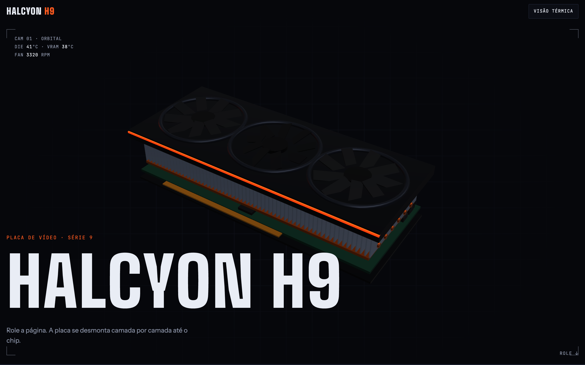
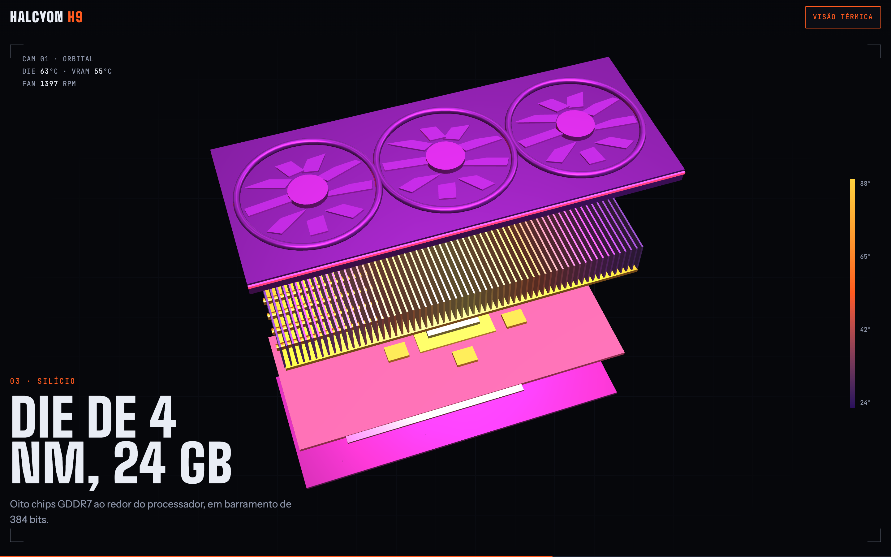
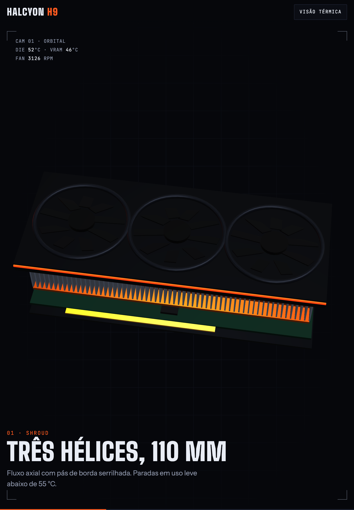
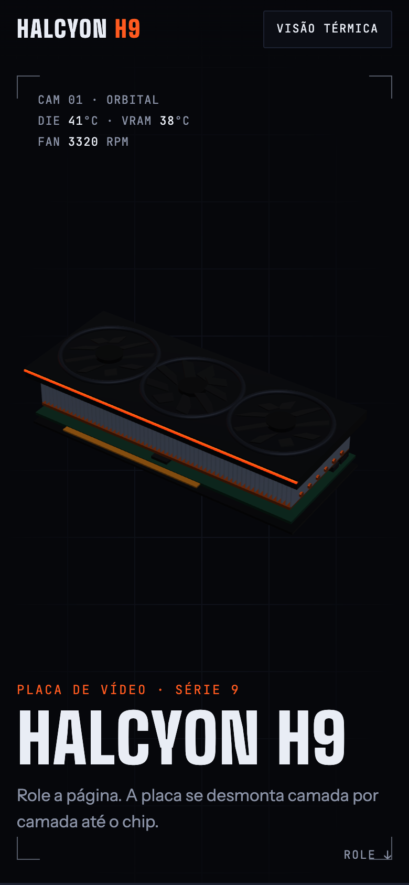
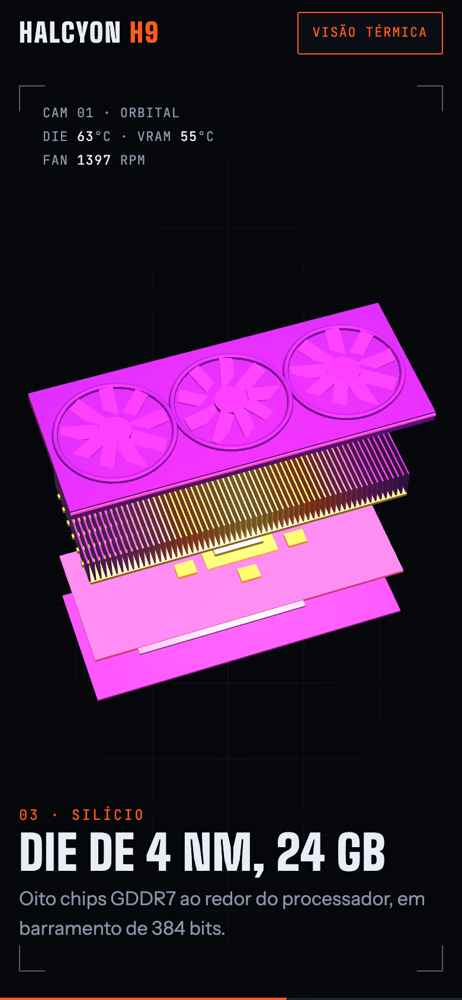
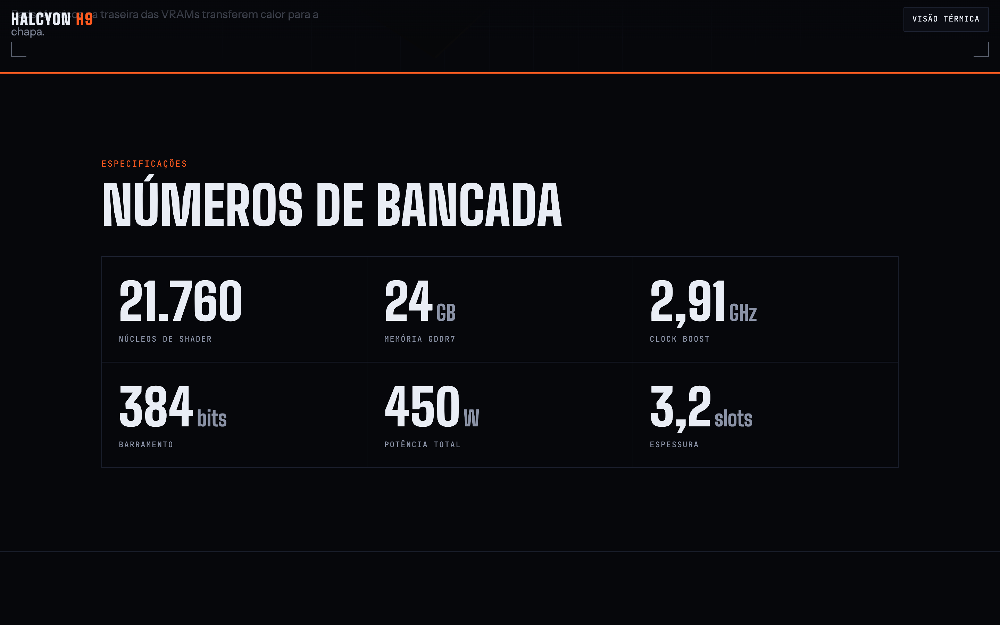

# Halcyon H9

Página de produto de uma placa de vídeo fictícia. Conforme você rola, o modelo 3D se desmonta camada por camada, do shroud com as hélices até o chip, com temperaturas e rotação das hélices ao vivo no HUD. Um botão liga a visão térmica e mostra onde a placa esquenta.





<p align="center">
  
  &nbsp;
  
  &nbsp;
  
</p>



## O que tem na página

- **Placa em 3D que se desmonta com o scroll**: cinco camadas (backplate, PCB, chips, dissipador e shroud) se afastam, a câmera recua e a placa gira
- **HUD ao vivo**: temperatura do die e da VRAM sobem conforme você chega ao chip; o RPM cai quando as hélices se soltam
- **Visão térmica**: cada peça muda para a cor da sua temperatura, com escala lateral
- **Legendas por capítulo** com transição, e o título da capa entrando letra por letra
- **Parallax** leve seguindo o mouse
- **Especificações** com contadores e **benchmarks** com barras que crescem conforme o scroll
- **Reserva** com preço animado

Funciona em qualquer tela: a câmera calcula a distância para a placa caber na largura, então no celular ela aparece inteira. Respeita a preferência do sistema por menos movimento.

## Tecnologias

| Tecnologia                                                                      | Uso                                                  |
| ------------------------------------------------------------------------------- | ---------------------------------------------------- |
| [Next.js 16](https://nextjs.org) (App Router)                                   | framework, renderização estática e fontes            |
| [React 19](https://react.dev) + [TypeScript](https://www.typescriptlang.org)    | interface e tipagem                                  |
| [React Three Fiber](https://r3f.docs.pmnd.rs) + [three.js](https://threejs.org) | modelo 3D, carregado só no navegador                 |
| [Motion](https://motion.dev)                                                    | animações ligadas ao scroll, contadores e transições |
| [Lenis](https://lenis.darkroom.engineering)                                     | scroll suave                                         |
| [Tailwind CSS 4](https://tailwindcss.com)                                       | estilos e layout responsivo                          |
| [Playwright](https://playwright.dev)                                            | geração dos prints deste README                      |
| ESLint + Prettier                                                               | padrão de código e formatação                        |

## Como rodar

Precisa de [Node.js](https://nodejs.org) 22 ou mais recente.

```bash
npm install
npm run dev
```

Abra http://localhost:3000. Para testar no celular na mesma rede Wi-Fi, rode `npm run dev -- -H 0.0.0.0` e acesse `http://<ip-do-seu-computador>:3000`.

### Comandos

| Comando               | O que faz                                                                                       |
| --------------------- | ----------------------------------------------------------------------------------------------- |
| `npm run dev`         | servidor de desenvolvimento                                                                     |
| `npm run build`       | verifica os tipos e gera a versão de produção                                                   |
| `npm run start`       | serve a versão de produção (depois do build)                                                    |
| `npm run lint`        | ESLint                                                                                          |
| `npm run format`      | Prettier em todo o projeto                                                                      |
| `npm run check`       | testa as regras do domínio (capítulos, temperaturas, paleta térmica, formatação)                |
| `npm run screenshots` | gera os prints em `docs/` (depois do build; na primeira vez, `npx playwright install chromium`) |

## Estrutura

```
src/
├── app/                    layout, página e estilos globais (Next.js)
├── domain/gpu.ts           regras do produto, sem React: capítulos, temperaturas,
│                           curva da desmontagem, paleta térmica, specs e benchmarks
├── components/
│   ├── atoms/              Chip, Counter
│   ├── molecules/          SectionHeading, BenchRow
│   └── organisms/
│       ├── Stage/          palco fixo: GpuScene (3D), Hud, Captions
│       └── ...             Nav, Specs, Benchmarks, Reserve, Footer
├── providers/              visão térmica, scroll suave e configuração do Motion
├── lib/                    utilitário cn
└── constants/              curvas de animação
```

Imports usam aliases: `@atoms/*`, `@molecules/*`, `@organisms/*`, `@domain/*`, `@providers/*`, `@lib/*`, `@constants/*`.

---

Produto fictício, criado como peça de portfólio.
